<p align="center">
  <picture>
    <source media="(prefers-color-scheme: dark)" srcset="https://raw.githubusercontent.com/Relay-Launch/councilverse/main/docs/assets/councilverse-banner-dark.png">
    
  </picture>
</p>

<p align="center">
  <strong>CouncilVerse v2</strong><br>
  The Sovereign Protocol for Multi-Agent Consensus, Fail-Closed Evaluation, and Cryptographic Governance.
</p>

<p align="center">
  <a href="https://www.npmjs.com/package/@relaylaunch/councilverse-voting"></a>
  <a href="https://www.npmjs.com/package/@relaylaunch/councilverse-formations"></a>
  <a href="https://pypi.org/project/councilverse/"></a>
  <a href="LICENSE"></a>
  <a href="https://github.com/Relay-Launch/councilverse/actions"></a>
</p>

---

### Why Single-Agent AI and Naive Multi-Agent Swarms Fail

When you ask a single frontier LLM a complex strategic question, the response is often **dangerously smooth**: persuasive, coherent, and blind to its own edge-case vulnerabilities.

When teams attempt naive multi-agent debates ("Agent A debates Agent B"), they encounter four critical failure modes:
1. **Majority Collusion & Sybil Consensus:** Multiple LLMs share overlapping training corpora, causing them to agree on shared hallucinations.
2. **Silent Downgrade:** When an evaluation model times out, routers quietly fall back to cheaper, faster models—substituting a 70B reasoning model with an 8B SLM without logging the downgrade.
3. **Floating-Point Non-Determinism:** Consensus scoring based on arbitrary floating-point weights produces flaky verdicts across different runtimes and architectures.
4. **Epistemic Drift & Lack of Provenance:** Without cryptographic binding, there is no proof that Agent B actually reviewed Agent A's objection before casting a vote.

**CouncilVerse v2 solves this.** It is the production-hardened open-source governance harness born inside the RelayLaunch autonomous fleet.

---

## The Three Sovereign Pillars of CouncilVerse v2

```mermaid
flowchart TD
    subgraph Pillar1 ["Pillar 1: Conformal Triadic Voting (CTV v2)"]
        JCS["RFC 8785 (JCS) Canonical Hashing"]
        BPS["Integer Basis Points (0-10000 bps)"]
        DAG["DAG Parent Linkage (vote_hashes)"]
        Quorum["2-of-3 Quorum Threshold"]
        Veto["Critical Dissent Fail-Closed Veto"]
        JCS --> BPS --> DAG --> Quorum --> Veto
    end

    subgraph Pillar2 ["Pillar 2: D4 Fail-Closed Evaluation"]
        ZeroRetry["num_retries: 0 on Evaluative Seats"]
        AntiDown["Anti-Downgrade Invariant (No Fallbacks)"]
        Breaker["D4.6 2-Abstain 15m Circuit Breaker"]
        ZeroRetry --> AntiDown --> Breaker
    end

    subgraph Pillar3 ["Pillar 3: Tamper-Evident Ledger Chaining"]
        Genesis["Genesis Anchor (0x00...00)"]
        PrevHash["prev_hash = SHA-256(last_ndjson_line)"]
        AuditVerify["O(1) Verification & Break Detection"]
        Genesis --> PrevHash --> AuditVerify
    end

    Pillar1 --> Composite["Unified Multi-Agent Consensus Verdict"]
    Pillar2 --> Composite
    Pillar3 --> Composite
```



### 1. Conformal Triadic Voting (CTV v2)
- **Mathematical Determinism:** Floating-point confidence values are banned in favor of integer **basis points (0–10000 bps)**.
- **RFC 8785 (JCS) Hashing:** Vote objects are canonicalized and hashed via SHA-256, creating tamper-evident `vote_hash` identifiers.
- **DAG Parent Links:** Every vote explicitly references its predecessor vote hashes (`parent_vote_hashes`), enforcing a verifiable deliberation graph.
- **Critical Dissent Veto:** A minority agent flagging `critical_dissent = true` triggers an immediate fail-closed `CRITICAL_DISSENT_VETO`, stopping harmful actions even if a 2-of-3 majority approved.

### 2. D4 Fail-Closed Evaluative Routing
- **Zero Retries Invariant (`num_retries: 0`):** Evaluative seats (judges, adversarial red-teamers) must never retry on a hang. A failed judge is recoverable; a hanging judge that stalls the fleet for 600 seconds is catastrophic.
- **Anti-Downgrade Enforcement:** Evaluative seats are forbidden from having fallback routes. If a 70B reasoning judge is unreachable, it must fail cleanly to `ABSTAIN`, never be quietly answered by a cheaper model.
- **D4.6 Circuit Breaker:** Two consecutive `ABSTAIN` verdicts trip a 15-minute circuit breaker, logging a quiet `digest` state to prevent infinite retry loops.

### 3. Cryptographic Tamper-Evident Ledgers
- Every agent event, vote, and dispatch in CouncilVerse is written to an append-only NDJSON stream.
- Each row carries `prev_hash = SHA256(previous_raw_line)`.
- If an attacker, rogue agent, or accidental merge script edits or deletes a historical verdict, the ledger chain breaks immediately at $O(1)$ verification time.

---

## Quickstart (TypeScript / Node.js)

### Installation

```bash
npm install @relaylaunch/councilverse-voting @relaylaunch/councilverse-formations
```

### Running a CTV Deliberation

```typescript
import { tallyCtvVotes, canonicalVoteHash, type CtvVote } from '@relaylaunch/councilverse-voting';

// 1. Agent 1 proposes an action
const voteClaude: CtvVote = {
  voter_id: 'claude-agentic-lead',
  lane: 'claude',
  topic: 'api-rate-limit-tier',
  decision_class: 'INFRA_ROUTING',
  vote: 'AFFIRMATIVE',
  confidence_bps: 9800, // 98.00%
  nonconformity_bps: 800, // 8.00%
  parent_vote_hashes: [],
  critical_dissent: false,
  justification: 'Enforcing zero retries on evaluative seats eliminates cascade hangs.',
};
const hashClaude = canonicalVoteHash(voteClaude);

// 2. Agent 2 reviews and references Agent 1's vote hash
const voteGemini: CtvVote = {
  voter_id: 'gemini-chief-strategist',
  lane: 'gemini',
  topic: 'api-rate-limit-tier',
  decision_class: 'INFRA_ROUTING',
  vote: 'AFFIRMATIVE',
  confidence_bps: 9500, // 95.00%
  nonconformity_bps: 1100,
  parent_vote_hashes: [hashClaude], // DAG link
  critical_dissent: false,
  justification: 'Concur. A failed judge is recoverable; a fake downgraded verdict is not.',
};

// 3. Agent 3 detects an anomaly and casts a critical dissent veto
const voteHermes: CtvVote = {
  voter_id: 'hermes-telemetry-observer',
  lane: 'hermes',
  topic: 'api-rate-limit-tier',
  decision_class: 'INFRA_ROUTING',
  vote: 'NEGATIVE',
  confidence_bps: 9200,
  nonconformity_bps: 3500,
  parent_vote_hashes: [hashClaude],
  critical_dissent: true, // VETO: Halts execution immediately!
  justification: 'Upstream gateway buffer pool is saturated; executing now causes packet drop.',
};

// 4. Compute consensus
const result = tallyCtvVotes([voteClaude, voteGemini, voteHermes]);
console.log(result.outcome); 
// Output: 'CRITICAL_DISSENT_VETO' (Fail-closed safety triggered!)
```

### Verifying a Tamper-Evident Ledger

```typescript
import { createChainedRow, verifyLedgerChain } from '@relaylaunch/councilverse-voting';

// Build chained lines
const line1 = JSON.stringify(createChainedRow({ id: '001', event: 'PROPOSAL' }, null));
const line2 = JSON.stringify(createChainedRow({ id: '002', event: 'VOTE_CAST' }, line1));

// Verify integrity
const audit = verifyLedgerChain([line1, line2]);
console.log(audit.valid); // true
console.log(audit.chained_rows); // 2
```

---

## Quickstart (Python SDK)

```python
from councilverse import CtvVote, tally_ctv_votes, canonical_vote_hash

v1 = CtvVote(
    voter_id="agent-claude",
    lane="claude",
    topic="d4-governance",
    decision_class="GOVERNANCE",
    vote="AFFIRMATIVE",
    confidence_bps=9500,
    nonconformity_bps=1200,
    parent_vote_hashes=[],
    critical_dissent=False,
    justification="Approved architecture."
)

v2 = CtvVote(
    voter_id="agent-gemini",
    lane="gemini",
    topic="d4-governance",
    decision_class="GOVERNANCE",
    vote="AFFIRMATIVE",
    confidence_bps=9200,
    nonconformity_bps=1400,
    parent_vote_hashes=[canonical_vote_hash(v1)],
    critical_dissent=False,
    justification="Concur with zero-retries proof."
)

result = tally_ctv_votes([v1, v2], required_quorum=2)
print("Outcome:", result["outcome"])  # CERTIFIED
print("Quorum Met:", result["quorum_met"])  # True
```

---

## The 15 Battle-Tested Council Rooms

CouncilVerse provides 15 pre-built council formations with specialized roles, prompt architectures, and dissent dynamics:

| Preset ID | Methodology | Best Used For |
|---|---|---|
| `strategy-room` | OODA Loop & Second-Order Effects | Strategic roadmaps, resource pivots, pricing changes |
| `tribunal` | Adversarial Prosecution & Defense | High-stakes code deploys, breaking refactors, architecture locks |
| `risk-council` | Premortem & Black Swan Analysis | Downside evaluation, security reviews, runway protection |
| `technical-review` | Formal Tradeoff & Scale Analysis | Database schemas, RPC protocols, caching layers |
| `crisis-response` | Triage & Blast-Radius Containment | Outages, API rate limits, production regression hotfixes |
| `due-diligence` | Fact-Check & Citation Audit | Claims verification, vendor evaluations, compliance audits |
| `innovation-lab` | Lateral Thinking & Reality Checks | Green-field product concepts, feature invention |
| `growth-council` | Pirate Metrics (AARRR) | Conversion funnels, retention loops, activation velocity |
| `ethics-board` | AI Alignment & PII Boundaries | Data privacy, customer trust, tenant boundary compliance |
| `market-intelligence` | Porter's Five Forces & Moat Analysis | Competitor responses, pricing defenses, category positioning |
| `quality-assurance` | Failure Mode & Effects Analysis (FMEA) | Edge-case fuzzing, contract tests, state machines |
| `research-council` | Hypothesis Testing & Empirical Scans | Model bake-offs, latency benchmarks, academic paper evaluation |
| `policy-council` | Regulatory & Governance Compliance | EU AI Act, SLA conformance, terms of service adherence |
| `investment-committee` | Unit Economics & Capital Allocation | Infrastructure COGS, token spend optimization, ROI auditing |
| `competitive-analysis` | Game Theory & Counter-Moves | Feature parity audits, attack-vector mitigation |

---

## Running the Examples

Run the bundled examples out of the box:

```bash
# Conformal Triadic Voting Demo
node examples/ctv-conformal-debate.mjs

# D4 Fail-Closed Router Validation
node examples/d4-failclosed-router.mjs

# Tamper-Evident Ledger Integrity Audit
node examples/tamper-evident-ledger.mjs

# Python SDK Verification
python examples/python_ctv_demo.py
```

---

## Contributing & Development

We welcome contributions from researchers, distributed systems engineers, and AI agent builders.

```bash
git clone https://github.com/Relay-Launch/councilverse.git
cd councilverse
npm install
npm test
```

## Commercial Provenance

CouncilVerse is open-sourced under the MIT license by [RelayLaunch LLC](https://relaylaunch.com) ("Every part of your business. One AI."). It represents the core deliberative spine powering Relay Deck and the Relay Recovery Engine.

**License:** MIT © RelayLaunch LLC
